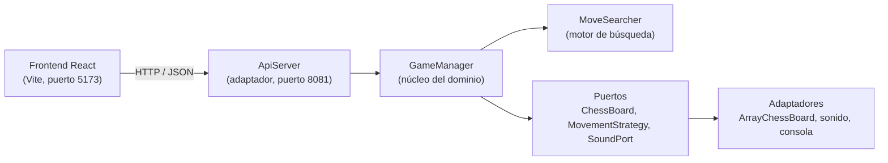

# Ajedrez Crossing

Juego de ajedrez contra la computadora con estética de Animal Crossing. Proyecto académico de Ingeniería de Software (UADE): un motor de ajedrez completo en Java con arquitectura hexagonal, expuesto como API HTTP y consumido por una interfaz web en React.


## Contenido

- [Características](#características)
- [Arquitectura](#arquitectura)
- [Estructura del repositorio](#estructura-del-repositorio)
- [Requisitos](#requisitos)
- [Puesta en marcha](#puesta-en-marcha)
- [Pruebas](#pruebas)
- [API HTTP](#api-http)
- [Inteligencia artificial](#inteligencia-artificial)
- [Personalización de audio](#personalización-de-audio)
- [Créditos y aviso legal](#créditos-y-aviso-legal)

## Características

**Reglas de ajedrez**

- Movimiento de todas las piezas con validación de jugadas legales (no se permite dejar al propio rey en jaque).
- Enroque corto y largo, captura al paso y coronación con elección de pieza (Dama, Torre, Alfil o Caballo).
- Detección de jaque, jaque mate y ahogado.
- Tablas por repetición triple de posición, regla de los 50 movimientos y material insuficiente.
- Deshacer: revierte una ronda completa (la jugada del jugador y la respuesta de la computadora). Se habilita una sola vez hasta que se realiza una nueva jugada.

**Juego contra la computadora**

- Tres niveles de dificultad (Fácil, Medio y Difícil), elegibles antes de empezar la partida.
- Pista: sugiere la mejor jugada disponible para el jugador.
- La computadora y la pista siempre coronan a Dama.
- Reloj de 10 minutos por jugador, con derrota por tiempo.

**Interfaz**

- Tablero animado: las piezas se deslizan, las capturas vuelan hacia la bandeja y se resalta la última jugada.
- Historial de movimientos en notación algebraica (R, D, T, A, C) con navegación hacia atrás y adelante, mediante botones o teclado.
- Puntaje de las piezas capturadas y descripción de cada pieza al pasar el cursor.
- Exportación de la partida en formato PGN (copiar o descargar).
- Reproductor de música de fondo con lista de temas y volúmenes independientes para música y efectos.
- Efectos de sonido distintos para movimientos, selección, jaque, enroque y fin de partida.
- Selección de fondo de pantalla y guía integrada de "Cómo se juega".

## Arquitectura

El backend sigue una **arquitectura hexagonal** (puertos y adaptadores): el dominio no conoce ni el protocolo HTTP ni el sistema de sonido; esos detalles se conectan desde afuera mediante puertos.



Patrones de diseño utilizados:

| Patrón | Dónde se aplica |
| --- | --- |
| Strategy | Una estrategia de movimiento por tipo de pieza (`MovementStrategy`) y estrategias de IA intercambiables |
| Command | `MoveCommand` encapsula una jugada y permite revertirla, base del historial y de Deshacer |
| Puertos y adaptadores | `ChessBoard` y `SoundPort` aíslan el dominio de la infraestructura |
| Service Locator | `ServiceLocator` provee las dependencias compartidas (por ejemplo, el sonido) |

## Estructura del repositorio

```text
ajedrezUade/
├── pom.xml
├── src/
│   ├── main/java/com/chess/
│   │   ├── core/        Dominio: piezas, reglas, GameManager, MoveSearcher, Difficulty
│   │   ├── ports/       Interfaces: ChessBoard, MovementStrategy, SoundPort, ServiceLocator
│   │   ├── adapters/    ApiServer (HTTP), estrategias de IA, sonido y consola
│   │   ├── Main.java    Ejecución por consola
│   │   └── WebMain.java Arranque del servidor web
│   └── test/java/com/chess/core/   Pruebas JUnit 5
└── frontend/
    ├── public/          Fondos, imagen de movimientos posibles y sonidos
    └── src/
        ├── App.jsx          Estado y lógica de la partida
        ├── App.css          Estilos
        ├── Api.js           Cliente de la API
        ├── sound.js         Efectos de sonido
        ├── music.js         Motor del reproductor
        ├── MusicPlayer.jsx  Interfaz del reproductor
        ├── HowToPlay.jsx    Guía de juego
        └── assets/          Imágenes de piezas, avatares, logo y música
```

## Requisitos

| Herramienta | Versión |
| --- | --- |
| JDK | 21 o superior |
| Maven | 3.8 o superior |
| Node.js | 20 o superior (incluye npm) |

## Puesta en marcha

El proyecto necesita **dos procesos en ejecución**: el backend y el frontend, cada uno en su propia terminal.

### 1. Backend

Desde la carpeta raíz del proyecto:

```bash
mvn compile
java -cp target/classes com.chess.WebMain
```

También puede ejecutarse `WebMain.java` directamente desde el IDE (VS Code o IntelliJ). El servidor queda escuchando en `http://localhost:8081`.

### 2. Frontend

En otra terminal:

```bash
cd frontend
npm install
npm run dev
```

Abrir la dirección que muestra Vite (por defecto `http://localhost:5173`). Si la pantalla muestra un error de conexión, verificar que el backend esté en ejecución.

### Otros comandos del frontend

```bash
npm run build     # genera la versión de producción en dist/
npm run preview   # sirve esa versión localmente
npm run lint      # análisis estático con oxlint
```

## Pruebas

```bash
mvn test
```

La suite cubre el modelo de piezas, las estrategias de movimiento, la detección de jaque y jaque mate, las reglas especiales (enroque, captura al paso, coronación y tablas), la notación algebraica, el deshacer, las estrategias de IA, el motor de búsqueda y una prueba de integración del motor completo. Los tests se ubican en `src/test/java/com/chess/core/`.

## API HTTP

El backend expone una API JSON en `http://localhost:8081/api` con CORS habilitado.

| Método | Ruta | Descripción |
| --- | --- | --- |
| `GET` | `/state` | Estado completo: tablero, turno, jugadas legales, capturas, historial, última jugada y dificultad |
| `POST` | `/move` | Realiza una jugada. Cuerpo: `{"fromRow":1,"fromCol":4,"toRow":3,"toCol":4}`; en una coronación se agrega `"promotion":"QUEEN" \| "ROOK" \| "BISHOP" \| "KNIGHT"` (por defecto, dama). La respuesta incluye la contestación de la computadora |
| `POST` | `/reset` | Inicia una partida nueva. Cuerpo opcional: `{"difficulty":"EASY" \| "MEDIUM" \| "HARD"}` |
| `POST` | `/undo` | Deshace la última ronda (jugada del jugador y respuesta de la computadora) |
| `GET` | `/hint` | Devuelve la mejor jugada sugerida para el jugador |
| `GET` | `/positions` | Devuelve todas las posiciones de la partida, para navegar el historial |

Convenciones del tablero: la fila 0 corresponde a las piezas blancas (jugador, Rosa), la fila 7 a las negras (computadora, Celeste) y la columna 0 a la columna `a`.

> Cada navegador genera un identificador y lo envía en la cabecera `X-Session-Id`; el servidor mantiene **una partida independiente por identificador**, así que cada persona juega la suya. Las partidas viven en memoria: se pierden al reiniciar el servidor y las inactivas se descartan a los 30 minutos. Un pedido sin la cabecera usa una partida compartida por defecto.

## Inteligencia artificial

La computadora usa un motor de búsqueda propio (`MoveSearcher`): minimax en formato negamax con poda alfa-beta, profundización iterativa con límite de tiempo, búsqueda de quietud para capturas y ordenamiento de jugadas por valor de captura. La evaluación combina material y posición de las piezas.

| Nivel | Comportamiento |
| --- | --- |
| Fácil | Jugadas aleatorias con preferencia por capturar |
| Medio | Búsqueda de poca profundidad, con variación entre jugadas de valor similar |
| Difícil | Búsqueda profunda y determinista, con límite de tiempo por jugada |

## Personalización de audio

Los archivos de audio no requieren cambios de código.

**Música de fondo.** Copiar archivos `.mp3`, `.ogg`, `.wav` o `.m4a` en `frontend/src/assets/music/`. El reproductor arma la lista con ellos, ordenada por nombre, y toma el título del nombre del archivo (`01-mi-tema.mp3` se muestra como "Mi tema"). Para quitar un tema, se borra el archivo.

**Efectos de sonido.** Se reemplazan los archivos de `frontend/public/sounds/` conservando el nombre:

| Archivo | Uso |
| --- | --- |
| `mover.mp3` | Movimiento normal del jugador |
| `mover-ia.mp3` | Movimiento normal de la computadora |
| `jaque-enroque.mp3` | Jaque y enroque |
| `seleccionar.mp3` | Selección de una pieza |
| `ganar.mp3` | Victoria |
| `perder.mp3` | Derrota |

Si falta alguno de estos archivos, el juego usa un sonido sintetizado equivalente.

## Créditos y aviso legal

**Integrantes del equipo**

- _Nombre y apellido_
- _Nombre y apellido_
- _Nombre y apellido_

**Materia:** Ingeniería de Software, UADE.

Este proyecto tiene fines exclusivamente educativos y no comerciales. Animal Crossing y sus personajes, imágenes, música y sonidos son propiedad de Nintendo. Este repositorio no está afiliado ni respaldado por Nintendo; los materiales de esa franquicia se utilizan únicamente con fines académicos.
